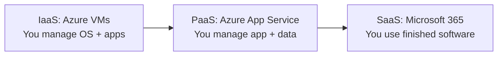
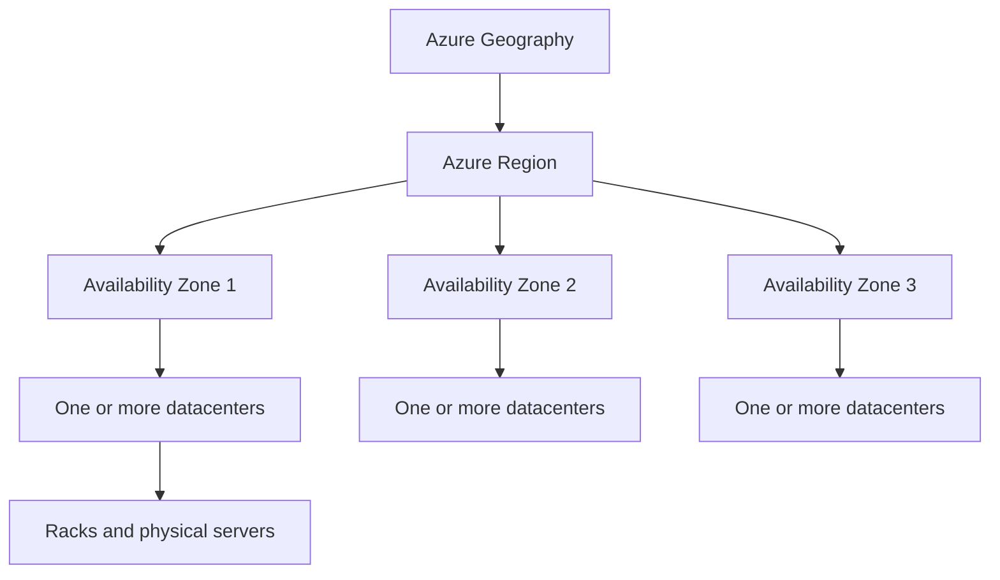
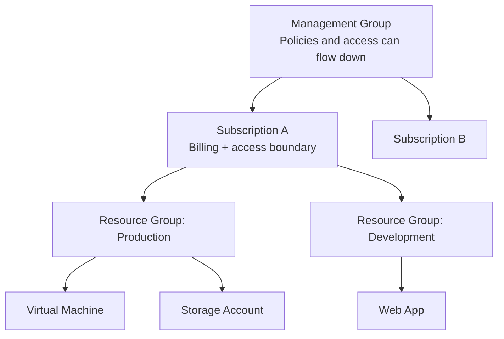
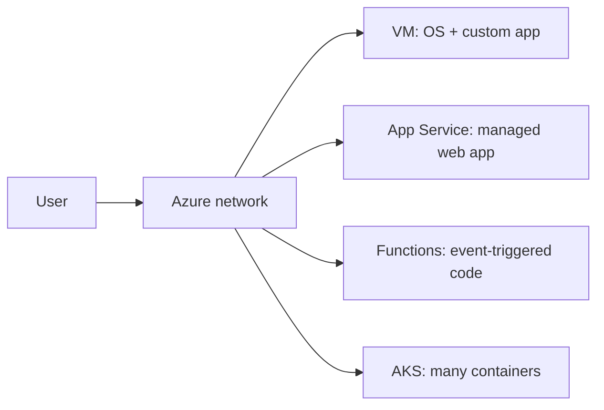
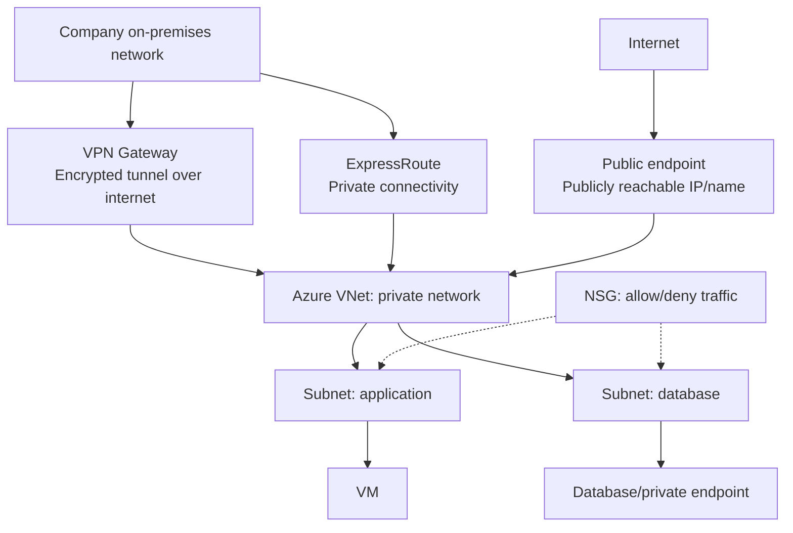
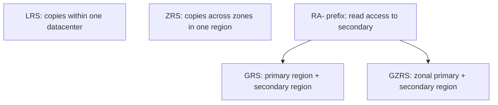
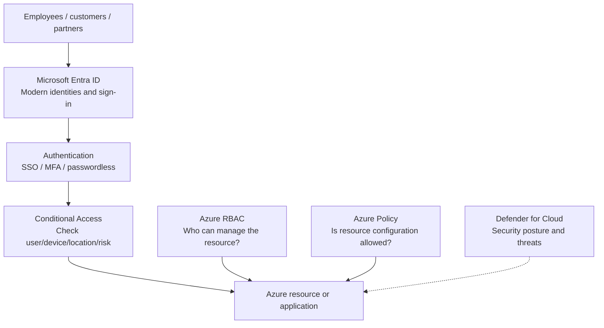
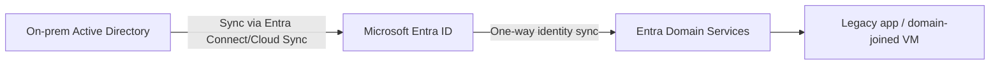
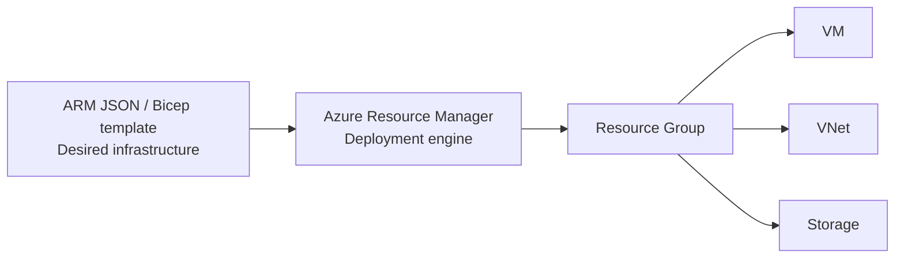

# AZ-900 Microsoft Azure Fundamentals — Final Exam Revision

> **Purpose:** One revision file for the entire course. Read the **bold terms**, follow the diagrams, and use the scenario tables to choose the right Azure service. Based on the Microsoft AZ-900 skills outline effective **July 20, 2026**.
>
> **Exam domains:** Cloud concepts **25–30%** · Azure architecture and services **35–40%** · Azure management and governance **30–35%**.

## 1. Cloud Concepts

### Cloud computing in one minute

**Cloud computing** = renting computing resources (servers, storage, databases, networking, software) over the internet rather than owning everything in your datacenter.

| Concept | Remember | Quick example |
|---|---|---|
| **Public cloud** | Provider-owned infrastructure shared across customers | Running a website in Azure |
| **Private cloud** | Cloud infrastructure dedicated to one organization | Company-controlled private datacenter |
| **Hybrid cloud** | Connects on-premises/private infrastructure with public cloud | On-prem database + Azure app |
| **Consumption-based pricing** | Pay for what you use | VM compute billed based on usage |
| **CapEx** | Upfront capital spending | Buying physical servers |
| **OpEx** | Ongoing operating spending | Monthly cloud usage bill |
| **Serverless** | Focus on code; provider manages servers and scaling infrastructure | Azure Functions |

**Benefits:** **High availability** = keep a service running; **scalability** = handle more demand; **elasticity** = scale up/down as demand changes; **reliability** = recover/continue after failures; **predictability** = forecast performance and cost; **governance** = apply rules; **manageability** = use portals, commands, and automation.

### IaaS vs PaaS vs SaaS (architecture view)

| Service model | You manage | Azure/provider manages | Choose when... |
|---|---|---|---|
| **IaaS** | OS, applications, data | Physical servers, virtualization | You need **operating-system control** |
| **PaaS** | Application/code and data | OS, runtime, infrastructure | You want to **deploy an app** without managing OS |
| **SaaS** | Users, access and data usage/configuration | Complete hosted application platform | You want **ready-to-use software** |

**Shared responsibility:** Microsoft always secures the **physical cloud infrastructure**; you always remain responsible for **your data, identities and access decisions**. Your responsibility for OS and application components is greatest with IaaS and decreases with PaaS/SaaS.

---

## 2. Azure Architecture

### Physical architecture: where workloads run

- **Region:** Geographic area containing Azure datacenters; choose for latency, compliance, pricing, and service availability.
- **Availability Zone:** Separate physical location within a supported region, with independent power/cooling/networking; protects against a datacenter-level failure.
- **Region pair:** Azure regions paired for certain disaster recovery/maintenance considerations. Not every Azure service automatically replicates across pairs.
- **Sovereign regions:** Separate environments for specific legal/sovereignty needs, including **Azure Government** and **Azure operated by 21Vianet in China**.
- **Availability set:** Spreads VMs across **fault domains** (different hardware failure points) and **update domains** (maintenance groups) within a datacenter-level deployment approach; **not the same as Availability Zones**.

### Azure management hierarchy

- **Resource:** A single Azure item (VM, storage account, VNet).
- **Resource group:** Logical container to manage related resources; a resource belongs to one resource group at a time.
- **Subscription:** Billing, access, and quota boundary; holds resource groups.
- **Management group:** Organizes multiple subscriptions; policies and RBAC assignments can inherit downward.
- **Azure Resource Manager (ARM):** Azure's **management/deployment layer** through which you create and manage resources.

---

## 3. Azure Compute and Application Hosting

| If the scenario says... | Choose | Why |
|---|---|---|
| Custom software **and full OS control** | **Azure Virtual Machines (VMs)** | IaaS, choose Windows/Linux OS |
| Many similarly configured VMs must scale | **Virtual Machine Scale Sets** | Scaled VM group |
| Protect VMs against rack/maintenance failures | **Availability Sets** | Fault/update domains |
| Host a website/API without managing servers | **Azure App Service** | Managed web-app hosting (PaaS) |
| Run a small **event-triggered code function** | **Azure Functions** | Serverless execution |
| Run a container quickly without orchestration | **Azure Container Instances (ACI)** | Simple container execution |
| Manage many containers with Kubernetes | **Azure Kubernetes Service (AKS)** | Managed Kubernetes orchestration |
| Run containerized apps with simpler serverless platform | **Azure Container Apps** | Managed container app platform |
| Provide remote Windows desktops/apps to employees | **Azure Virtual Desktop** | Cloud-hosted desktop experience |
| Run large parallel jobs | **Azure Batch** | Batch/parallel workloads |
| Coordinate workflow across services | **Azure Logic Apps** | Low-code workflow automation |
| Route events to subscribers | **Azure Event Grid** | Event routing |

**VM vs container vs function:** VM includes its **own OS**; a container packages an app and dependencies and **shares the host OS kernel**; a function runs **code on demand** while Azure manages most of the infrastructure.

**VM needs supporting resources:** compute size, **OS/data disks**, networking (NIC/VNet/subnet), and optionally public IP. **Spot VMs** offer discounted spare capacity but may be evicted; **reservations** trade commitment for lower eligible resource prices.

---

## 4. Azure Networking

### VNet architecture view

| Term | What it means |
|---|---|
| **VNet** | Private network for Azure resources |
| **Subnet** | Smaller IP-address segment inside a VNet |
| **Network Security Group (NSG)** | Allow/deny **network traffic** based on rules |
| **VNet peering** | Connect two VNets privately over Microsoft's backbone |
| **Route table / UDR** | Control where network traffic goes |
| **VPN Gateway** | Encrypted connection through the internet |
| **Point-to-Site VPN** | One person's computer connects to Azure |
| **Site-to-Site VPN** | Entire office/on-prem network connects to Azure |
| **ExpressRoute** | Private connectivity to Microsoft's cloud, not a standard internet VPN |
| **Public endpoint** | Reachable through a public network address (subject to access controls) |
| **Private endpoint / Private Link** | Private IP in your VNet to access a supported Azure service privately |
| **Azure Bastion** | Secure RDP/SSH access to VMs without giving VMs public IP addresses |
| **Azure DNS** | Host DNS zones and records; **DNS converts names to addresses** |
| **Traffic Manager** | DNS-based routing to suitable endpoints; it does **not proxy application traffic** |

**Exam clues:** Individual employee connecting → **Point-to-Site**; office network → **Site-to-Site**; private dedicated connectivity → **ExpressRoute**; connect two VNets → **Peering**; access a PaaS service via private IP → **Private Endpoint**.

---

## 5. Azure Storage and Migration

| Storage service | Think of it as | Example |
|---|---|---|
| **Blob Storage** | Object storage for unstructured data | Photos, videos, backups, files |
| **Azure Files** | Managed shared file folders using SMB/NFS | Shared company folder |
| **Queue Storage** | Messages waiting to be processed | Orders awaiting processing |
| **Table Storage** | Simple NoSQL key/attribute storage | Flexible non-relational records |
| **Managed Disks** | Persistent disks for VMs | VM operating system disk |

**Storage account** holds supported storage services; **General-purpose v2** is the standard versatile account type. Premium options target particular high-performance storage needs.

### Blob access tiers

**Hot** = frequent access; **Cool** = less frequent; **Cold** = rarely accessed; **Archive** = long-term, offline tier that requires rehydration before reading. Lower storage price can mean **higher access/retrieval cost**.

### Redundancy architecture view

- **LRS:** Local redundancy within a single datacenter.
- **ZRS:** Redundancy across availability zones in one region.
- **GRS:** Local redundancy in the primary region **plus** replication to another region.
- **GZRS:** Zone-redundant primary region **plus** replication to another region.
- **RA-GRS / RA-GZRS:** Adds ability to **read from the secondary region** when supported.

### Move and synchronize data

| Tool | Best use |
|---|---|
| **AzCopy** | Command-line copy to/from Azure Storage |
| **Azure Storage Explorer** | GUI to browse and manage storage |
| **Azure File Sync** | Synchronize Windows Server shares with Azure Files, optional cloud tiering |
| **Azure Migrate** | Discover, assess, and migrate on-premises workloads to Azure |
| **Azure Data Box** | Physically ship large datasets when network transfer is impractical |
| **Azure Database Migration Service** | Help migrate supported databases to Azure |

---

## 6. Identity, Access, and Security — THE BIG PICTURE

### Architecture: who signs in, who gets access, what gets protected?

**Authentication** = *Are you really this person?*  **Authorization** = *What are you allowed to do?*

### Identity services

| Service | Recognize it by |
|---|---|
| **Microsoft Entra ID** | Cloud user accounts, sign-in to Microsoft 365/Azure/SaaS, groups, SSO |
| **Microsoft Entra Domain Services** | Legacy **domain join, LDAP, Group Policy, Kerberos, NTLM** without managing domain controllers |
| **Entra External ID — external tenant** | Customers signing into customer-facing apps |
| **B2B Collaboration** | Invite partner/contractor as a **guest** in your tenant |
| **B2B Direct Connect** | Cross-company **Teams shared channels**, without ordinary guest accounts |

**Hybrid identity flow (when on-prem AD exists):**

**Domain controller** = server used by traditional Windows domains to verify logins and apply domain policies; Entra Domain Services runs managed domain controllers in Azure for you.

### Sign-in and policy methods

| Term | Meaning / exam clue |
|---|---|
| **SSO** | Sign in once to access multiple connected apps |
| **MFA** | Verify with **different factors** (e.g., password + authenticator approval) |
| **SSPR** | User resets their own password without calling IT |
| **Password protection** | Blocks common/banned weak passwords |
| **Passwordless** | Sign in without a traditional password (Windows Hello, FIDO2 key, Authenticator) |
| **Conditional Access** | **If** sign-in is from risky location/device, **then** require a control or block access |
| **PIM** | Privileged Identity Management: eligible role activated when needed vs permanently active assignment |

**Factors:** Something you **know** (password/PIN); **have** (security key/phone); **are** (biometrics). A passwordless method can still involve multiple factors.

### Roles and security principles

- **Microsoft Entra roles:** Manage identities/directory tasks. **Global Administrator** = broad Entra administration; **User Administrator** = users/groups; **Billing Administrator** = appropriate billing administration.
- **Azure RBAC:** Manage **Azure resources** using role assignments (e.g., Reader, Contributor, Owner) at management group/subscription/resource group/resource scope. **Global Administrator does not automatically equal Owner of every subscription.**
- **Least privilege:** Only the permissions necessary.
- **Zero Trust:** **Verify explicitly · Use least privilege · Assume breach**. Never automatically trust even an internal network.
- **Defense in Depth:** Multiple layers: **physical → identity → perimeter → network → compute → application → data**.
- **CIA Triad:** **Confidentiality** (keep secret); **Integrity** (keep accurate); **Availability** (keep accessible).
- **Microsoft Defender for Cloud:** **Assess → Secure → Defend** across Azure, hybrid, AWS, and GCP. **Secure Score** summarizes implemented security recommendations; Defender plans offer workload threat protection.

---

## 7. Governance, Compliance and Cost

### Do not mix these tools up

| Tool | Question it answers |
|---|---|
| **Azure RBAC** | **Who** can manage this VM/storage account? |
| **Azure Policy** | **What configurations** are allowed? (approved regions, required tags) |
| **Policy Initiative** | Can we **group multiple policies** for one compliance objective? |
| **Resource Lock — CanNotDelete** | Can people edit but **not delete** this resource? |
| **Resource Lock — ReadOnly** | Can people **only read** this resource? |
| **Tags** | How do we **label** and organize resources/costs? |
| **Microsoft Purview** | How do we **discover, classify, govern and protect data**? |
| **Defender for Cloud** | What are cloud **security weaknesses and threats**? |

**Tags** = `Name: Value`, for example `Environment: Production`. Tags on a resource group **do not automatically pass** to its resources. Tags do not provide access control. Azure Policy can require tags.

**Microsoft Purview:** Microsoft collection of data governance, risk and compliance capabilities, including **data discovery/catalog, classification, data protection, and compliance**. Think *data visibility and governance*, not VM performance monitoring.

### Compliance tools — choose by purpose

- **Microsoft Privacy Statement:** How Microsoft collects, uses, and handles personal data.
- **Microsoft Trust Center:** Explanations of Microsoft's security, privacy, and compliance practices.
- **Service Trust Portal:** Audit reports, certifications, and compliance documents.
- **Microsoft Purview Compliance Manager:** Assessments, recommended improvements, **compliance score**, evidence and tracking.
- **GDPR:** European personal-data protection law; **HIPAA:** US health-information protection; **NIST:** cybersecurity standards/guidance; **CJIS:** criminal-justice information rules; **CSA STAR:** cloud security assurance program.
- **Azure Government:** Separate cloud for eligible US government-related needs. **Azure China:** Separate cloud operated by **21Vianet**.

### Cost: before deployment vs after deployment

| Tool or idea | When to use |
|---|---|
| **Azure Pricing Calculator** | **Estimate Azure service costs** before deployment |
| **TCO Calculator** | Compare estimated **on-premises vs Azure** costs |
| **Microsoft Cost Management** | Review actual spending, forecasts, **budgets and alerts** |
| **Azure Advisor** | Personalized recommendations: **cost, reliability, security, performance, operational excellence** |
| **Reservations** | Lower eligible pricing via 1- or 3-year commitment |
| **Spending limit** | Supported credit-based subscriptions; **not standard pay-as-you-go** |

**Cost drivers:** resource type/size, usage duration, region, storage tier, licensing/offer, and outbound data transfer. Inbound data is often free; outbound can cost money. **Budget alerts are notifications, not an automatic shutdown.** Billing zones for data transfer are **not Availability Zones**.

**Purchasing routes:** **Enterprise Agreement** = negotiated enterprise terms; **Web Direct** = purchase directly from Microsoft; **CSP** = purchase through a Microsoft partner.

### Infrastructure as Code (important exam topic)

**Infrastructure as Code (IaC)** = describe cloud resources in files so you can **repeatedly deploy the same environment** instead of clicking manually.

- **ARM template:** Declarative **JSON** file defining desired Azure resources.
- **Bicep:** Simpler declarative language that deploys through Azure Resource Manager.
- **Azure Deployment Stacks:** Manage a collection of resources through ARM/Bicep with lifecycle and deny-setting options.
- **Azure Blueprints:** Older governed deployment feature **retiring January 31, 2027**; Microsoft recommends **Deployment Stacks** and **Template Specs** for migration. It is **not in the current AZ-900 skills list as a named objective**.

---

## 8. Monitoring and Management

### See the three different monitoring questions

| User asks... | Tool |
|---|---|
| Is my **app slow or throwing errors**? | **Application Insights** in Azure Monitor |
| Is my **VM using too much CPU**? | **Azure Monitor metrics / VM Insights** |
| What do my **logs show**? | **Log Analytics** (query logs using KQL) |
| Did someone **create or delete a resource**? | **Azure Activity Log** |
| Notify me when CPU rises above a threshold | **Azure Monitor Alert** |
| Should capacity grow as traffic increases? | **Autoscale** |
| Is Azure having **a worldwide service outage**? | **Azure Status** |
| Does **an Azure outage/maintenance affect my subscription**? | **Azure Service Health** |
| Is **my specific Azure resource** healthy? | **Azure Resource Health** |
| How can I improve cost, security and reliability? | **Azure Advisor** |

**Azure Monitor** collects **metrics** (numbers such as CPU%) and **logs** (events/records), then supports alerts, dashboards, analysis and autoscale. **Application Insights** monitors app performance; **Container Insights** monitors Kubernetes workloads; **VM Insights** monitors VMs.

### Azure administration tools

| Tool | Remember |
|---|---|
| **Azure Portal** | Browser-based graphical management |
| **Azure CLI** | Cross-platform commands (`az ...`) |
| **Azure PowerShell** | PowerShell cmdlets (`Az` module) |
| **Azure Cloud Shell** | Browser-based shell with CLI and PowerShell |
| **Azure mobile app** | Monitor/manage selected resources on phone |
| **Azure REST API** | Manage Azure programmatically over HTTP |
| **Azure Arc** | Manage supported on-prem/multicloud assets using Azure tools |

---

## 9. Fast Scenario Recognition — Read Before the Exam

| Exam question mentions... | Answer to think of first |
|---|---|
| Full control over Windows/Linux OS | **Azure Virtual Machines / IaaS** |
| Website hosting without managing OS | **Azure App Service / PaaS** |
| Event-driven code, no server management | **Azure Functions** |
| Kubernetes orchestration | **AKS** |
| Virtual desktop for employees | **Azure Virtual Desktop** |
| Multi-zone resilience within one region | **Availability Zones** |
| Group subscriptions under common rules | **Management Groups** |
| Private network connecting Azure resources | **VNet** |
| Allow/deny network traffic | **NSG** |
| Office to Azure over encrypted internet tunnel | **Site-to-Site VPN** |
| Dedicated private Azure connectivity | **ExpressRoute** |
| Private IP access to Azure PaaS service | **Private Endpoint** |
| Store images/videos/unstructured objects | **Blob Storage** |
| Shared SMB/NFS folders | **Azure Files** |
| VM operating system storage | **Managed Disks** |
| Archive rarely used data | **Archive Blob tier** |
| Replicas across zones in one region | **ZRS** |
| Copies to secondary region | **GRS/GZRS** |
| Bulk data shipped on physical device | **Azure Data Box** |
| Microsoft 365/Azure employee login | **Microsoft Entra ID** |
| LDAP / Kerberos / Group Policy | **Entra Domain Services** |
| Customers signing into your app | **Entra External ID external tenant** |
| Partner invited as guest | **B2B Collaboration** |
| Teams shared channels across companies | **B2B Direct Connect** |
| Extra login verification | **MFA** |
| Conditional sign-in by location/device/risk | **Conditional Access** |
| Who may manage Azure resources? | **Azure RBAC** |
| Only give needed access | **Least privilege / Zero Trust** |
| Multiple layers of protection | **Defense in Depth** |
| Security posture and Secure Score | **Microsoft Defender for Cloud** |
| Only approved regions/VM sizes | **Azure Policy** |
| Several policy rules grouped | **Policy Initiative** |
| Cannot delete production resource | **CanNotDelete lock** |
| Cannot edit or delete resource | **ReadOnly lock** |
| Find/classify/govern sensitive data | **Microsoft Purview** |
| Download Microsoft audit reports | **Service Trust Portal** |
| Compliance assessment and score | **Purview Compliance Manager** |
| Estimate monthly Azure usage cost | **Pricing Calculator** |
| Compare on-prem costs to Azure | **TCO Calculator** |
| Actual spending and budget alerts | **Cost Management** |
| Repeat deployments using code | **IaC / ARM template / Bicep** |
| Query collected logs | **Log Analytics** |
| Azure platform incident affects your region | **Service Health** |
| Your particular VM's Azure-reported health | **Resource Health** |
| Application response time and exceptions | **Application Insights** |

## 10. Last-Day Revision Checklist

- [ ] Explain **IaaS / PaaS / SaaS** and shared responsibility without notes.
- [ ] Draw **Region → Availability Zone → Datacenter**.
- [ ] Draw **Management Group → Subscription → Resource Group → Resource**.
- [ ] Compare **VM / Container / Function / App Service**.
- [ ] Compare **VPN / ExpressRoute / VNet Peering / Private Endpoint**.
- [ ] Recall **Blob / Files / Disks** and **LRS / ZRS / GRS / GZRS**.
- [ ] Distinguish **Entra ID / Domain Services / External ID**.
- [ ] Distinguish **MFA / Conditional Access / Azure RBAC / Azure Policy**.
- [ ] Recall **Zero Trust / Defense in Depth / Defender for Cloud**.
- [ ] Distinguish **Pricing Calculator / TCO / Cost Management**.
- [ ] Distinguish **Azure Monitor / Service Health / Resource Health / Advisor**.
- [ ] Know **Purview**, **IaC/ARM**, and **Log Analytics**.
- [ ] Practice scenario questions and review every incorrect answer.

---

### Official references and current status

- [Microsoft AZ-900 study guide (skills measured July 20, 2026)](https://learn.microsoft.com/en-us/credentials/certifications/resources/study-guides/az-900)
- [Microsoft Azure Fundamentals certification](https://learn.microsoft.com/en-us/credentials/certifications/azure-fundamentals/)
- [Azure Blueprints retirement and migration](https://learn.microsoft.com/en-us/azure/governance/blueprints/overview)

*Exam reminder:* Understand **what each service solves**. AZ-900 tests service selection and fundamental architecture more than command syntax or detailed setup steps.
